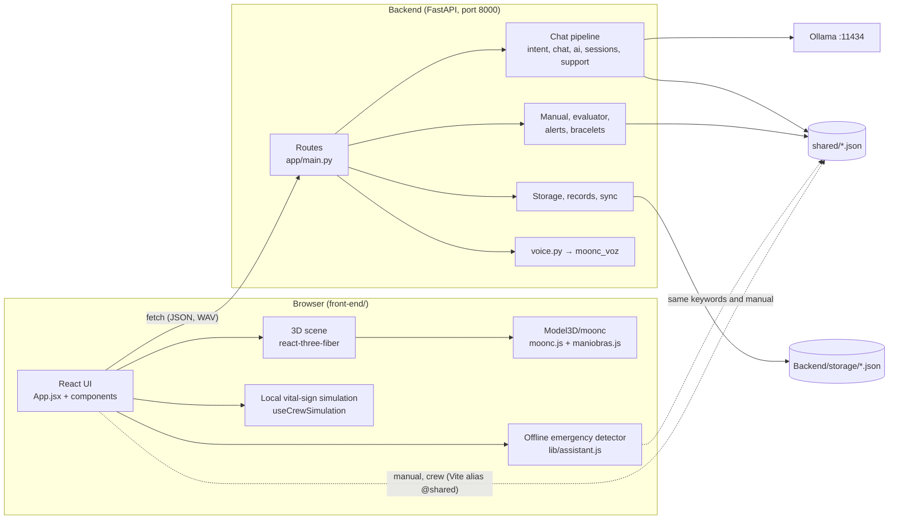
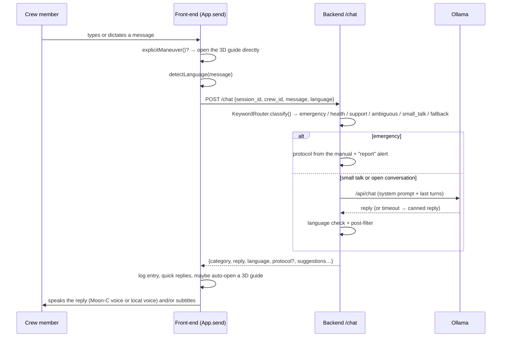

# Architecture

Moon-C runs fully offline on one machine. It has five parts:

| Part | Folder | Runtime | Role |
|---|---|---|---|
| Backend | `Backend/` | Python 3.11+, FastAPI, one Uvicorn process | Chat router, health manual, simulated bracelets, alerts, storage, Earth sync, text-to-speech endpoint |
| Front-end | `front-end/` | React 19 + Vite 6 + react-three-fiber | The screen: 3D Moon-C, chat, vital signs, alerts, announcements, guided maneuvers |
| 3D character and maneuvers | `Model3D/moonc/` | Plain ES modules + three.js | Moon-C's rigged body, face shader, manikins and the step-by-step maneuver logic. Imported by the front-end |
| Voice | `moonc_voz/` | Python (Piper + Praat) | Moon-C's own Spanish voice. Imported by the backend (optional install) |
| Shared data | `shared/` | JSON files | Health manual, router keywords, crew, support replies and the test cases both sides must agree on |
| Local AI (external) | — | [Ollama](https://ollama.com) with `qwen3.5:4b` | Small talk only. Optional |

## Component view

In words: the browser talks to the backend over HTTP (`front-end/src/lib/api.js`). The backend reads `shared/` at startup, keeps live state (alerts, chat context, live signs) in memory and writes only measurements and safety records to `Backend/storage/`. The front-end also imports `shared/` at build time (through the Vite alias `@shared`), so that it can work alone when the backend is unreachable.

## Process and timing view

**Backend.** A single Uvicorn process (do not run several workers: alerts, sessions and live signs live in memory). At startup the lifespan handler builds every service and starts these background tasks ([backend/README.md](backend/README.md#startup-and-shutdown)):

| Task | Period | What it does |
|---|---|---|
| Ollama warm-up | once | Loads the model into memory (`keep_alive` 30 min) without delaying startup |
| Session sweeper | 60 s | Drops chat contexts idle for more than 10 min |
| Earth sync | 60 s | When the simulated link is `online`, marks pending data as synced |
| Voice loading | once (~3 s, in a thread) | Loads the Piper model and warms it up |
| Simulated bracelets | 2.5 s | Moves every crew member's live signs, stores status changes, raises alerts |

**Front-end.** Everything is polling, no WebSockets:

| What | Period | Hook |
|---|---|---|
| Backend health (`GET /status`) | 20 s | `useBackendStatus` |
| Live signs and alerts (`GET /vitals`, `GET /alerts`) | 2.5 s | `useRemoteCrew` |
| Announcements | 30 s | `useAnnouncements` |
| Earth link status | 20 s | `useSyncStatus` |
| Local simulation tick (no backend) | 2.5 s | `useCrewSimulation` |
| Chat inactivity check | 30 s (clears after 10 min idle) | `App.jsx` |

## Main data flows

### 1. A chat message

- The routing order and every category are explained in [backend/chat/README.md](backend/chat/README.md).
- If the backend does not answer, the front-end runs `askLocal()` ([offline-assistant.md](frontend/lib/offline-assistant.md)): it only handles emergencies, with the same keywords, rules and manual.
- Only short-lived context is kept, in memory ([sessions.md](backend/chat/sessions.md)).

### 2. Vital signs and alerts

1. `SimulatedBracelets.tick()` moves each crew member's signs toward a baseline (or toward a demo scenario) every 2.5 s ([bracelets-and-crew.md](backend/health/bracelets-and-crew.md)).
2. Each value is classified with the manual's ranges ([evaluator.md](backend/health/evaluator.md)).
3. When an indicator enters the urgent range, an on-board `vital` alert is created (one per crew member and indicator) and the reading is stored.
4. The front-end polls `/vitals` and `/alerts?language=<account language>` and converts them with `lib/vitals.js` ([alerts-and-vitals.md](frontend/lib/alerts-and-vitals.md)).
5. New alerts are announced (voice and/or subtitle) to the General account and to the affected crew member's account. The General account can open the crew member's data only while an alert is active; the access is recorded with `POST /access-log`.

Readings entered by hand (`POST /measurements`) follow the same evaluation and alert rules; a reading without `crew_id` is stored as unassigned until someone confirms whose it is.

### 3. Guided maneuvers (CPR, tourniquet, choking)

1. A guide opens from the menu, from a button in the chat log, when the user names it ("guíame con la RCP"), or automatically after an unambiguous emergency reply ([frontend/lib/maneuvers.md](frontend/lib/maneuvers.md)).
2. The front-end calls `POST /maneuvers/start`, which raises a `maneuver` alert for the crew and the medical officer.
3. `MoonCModel` loads the manikin and creates the controller with `crearManiobra()` from `Model3D/moonc/maniobras.js` ([model3d/maneuvers.md](frontend/model3d/maneuvers.md)). Moon-C animates each step and reads it aloud.
4. On the "Report to Earth" step, the front-end converts the guide's summary (`paqueteTierra()`) and stores it with `POST /maneuvers/reports`. It is queued for the next contact with Earth.

### 4. Voice

- **Output.** Spanish replies are spoken with Moon-C's own voice: the front-end splits the text into sentences and calls `POST /tts` for each one, playing one while the next is synthesized, and moves her mouth with the real volume of the audio ([frontend/lib/voice.md](frontend/lib/voice.md), [backend/voice/tts.md](backend/voice/tts.md)). English replies, or a backend without the voice, use a voice installed on the machine (never a network voice). Without any voice for the language, the text is shown as a subtitle.
- **Input.** Dictation uses the browser's Web Speech API (Chrome, Edge). It sends audio to an online service; typing works offline.

### 5. Earth sync

Assigned measurements and maneuver reports carry `synced: false` until a contact window. `POST /sync/simulate` (button in the General account's menu) or the background loop with `MOON_C_EARTH_LINK=online` marks them as synced. Nothing is actually transmitted ([earth-sync.md](backend/data/earth-sync.md)).

## Online and offline modes

The front-end checks `GET /status` every 20 s. Each feature degrades on its own:

| Feature | Backend reachable | Backend unreachable |
|---|---|---|
| Chat | Full router, manual, AI small talk, support | Emergencies only (`askLocal`), same keywords and manual; other messages get "I can only help with emergencies" |
| Live signs and alerts | From the backend's simulated bracelets, shared by every screen | Simulated in the browser (`useCrewSimulation`), this screen only |
| Announcements | Stored in the backend, seen by every screen | Two seed announcements; new ones stay on this screen |
| Logging readings, Earth sync, export, wipe | Available in the menu | Hidden with a "needs a link" note |
| Maneuver report | Stored and queued | The guide says the summary was not saved; write it down by hand |
| Voice | Moon-C's voice for Spanish (if installed) | Local browser voice, or subtitles |

Inside the backend, Ollama is optional too: when it is stopped, slow or the model is missing, small talk uses canned replies (`ai_used: false`) and a circuit breaker skips Ollama for 10 s after a connection failure ([local-ai.md](backend/chat/local-ai.md)).

## Languages

| Text | Language rule | Where |
|---|---|---|
| Moon-C's chat reply | The language of each message, detected by counting common words. Unclear messages ("ok", "SpO2") keep the session's last language, then the request's, then the crew member's `preferredLanguage`, then English | `Backend/app/language.py`, mirrored in `front-end/src/lib/language.js` |
| AI replies | The system prompt names the reply language; a reply in the other language is replaced by a canned one | `Backend/app/ai.py`, `chat.py` |
| The screen of a crew member | Their `preferredLanguage` (by nationality, `shared/crew.json`) | `front-end/src/App.jsx` |
| The screen of the General account | Follows its conversation; ES/EN switch in the top bar and in the menu | `App.jsx`, `TopBar.jsx` |
| Alerts | Requested with `?language=` (English by default); the front-end asks for the language of the account that sees them | `Backend/app/alerts.py`, `front-end/src/lib/alerts.js` |
| Maneuver steps | The screen's language; switching mid-guide only changes the texts | `Model3D/moonc/maniobras.js` (`EN`) |
| Speech | Each text is read with a voice of its own language | `front-end/src/hooks/useSpeech.js` |

## Single source of truth and drift protection

Several rules exist on both sides on purpose, so the front-end still detects emergencies without the backend. Tests keep them in sync:

| Rule | Backend | Front-end | Guarded by |
|---|---|---|---|
| Emergency detection (phrases, weak phrases, stems, negation, pain questions) | `app/intent.py` | `src/lib/assistant.js` | `shared/router_cases.json`, read by `tests/test_shared_cases.py` and `src/lib/assistant.test.js` |
| Language detection word lists | `app/language.py` | `src/lib/language.js` | `shared/language_cases.json` and `test_router_flows.py::test_language_word_lists_match_the_front_end` (compares the word sets) |
| Range classification (urgent > normal > attention) | `app/evaluator.py` | `src/data/manual.js` (`classify`) | Both read `shared/protocols.json` |
| Demo scenarios | `app/bracelets.py` (`SCENARIOS`) | `src/hooks/useCrewSimulation.js` (`EMERGENCY_TYPES`) | `test_bracelets.py::test_scenario_ids_match_the_front_end` and `src/lib/vitals.test.js` |
| Crew baselines | `app/bracelets.py` (`BASELINES`) | `useCrewSimulation.js` (`BASELINE`) | Same values, kept by hand |

See [shared-data.md](shared-data.md) for every file in `shared/`.

## Accounts and access to personal data

- **General account** (`general`): shared screen. Posts announcements, sees the crew overview. A crew member's vital signs are locked and open only while that person has an active alert; opening them is recorded (`POST /access-log`, with the alert id as the reason) and shown in the emergency view.
- **Crew accounts** (`moises`, `ana`, `ruben`, `valentina`): own live signs, "what to do" from the manual, own chat.
- Switching account clears the previous account's conversation on the screen and in the backend (`POST /session/reset`), and identifies the new crew member with the simulated bracelet (`POST /identify`).

> ⚠️ There is no authentication. The backend trusts the `crew_id` the client sends, and the "individual data only in an emergency" rule is enforced only in the UI. This is an accepted limitation of the demo.

## Privacy model

| Data | Where it lives | Lifetime |
|---|---|---|
| Chat messages, transcripts, audio | Nowhere on disk; never logged | Chat context in memory: at most 10 turns, cleared after 10 min idle, on account switch, on `/identify` and on `/session/reset` |
| Text sent to `/tts` | Nowhere; never logged | Only for the synthesis |
| Measurements | `Backend/storage/measurements.json` | Whole mission by default (`MOON_C_RETENTION_DAYS`) |
| Maneuver reports, access log, announcements | `Backend/storage/*.json` | Same retention |
| Alerts | Memory only (a chat alert keeps only the protocol name) | Until restart or resolve |
| Live signs | Memory only; stored only on status changes and in a periodic snapshot (15 min) | Until restart |
| Support profiles | `shared/profiles/<crew_id>.json` (gitignored), read at startup | Kept in memory; never logged, exported or sent to Earth |

`DELETE /data?confirm=true` wipes measurements, maneuver reports and the access log, and clears alerts and chat contexts (announcements are kept). See [backend/data/storage.md](backend/data/storage.md).

> ⚠️ The repository lives in a OneDrive folder, so `Backend/storage/` is uploaded to the cloud. For real use, point `MOON_C_STORAGE_PATH` to a folder that is not synced.

## Known limitations (by design for the demo)

- Ranges come from published guidelines and NASA standards but **must be validated by medical experts**; protocol steps are illustrative.
- The router matches keywords. It cannot read negation in general ("I don't have chest pain" asks for confirmation instead of opening the protocol), does not handle most typos and only knows English and Spanish.
- Vital signs come from a simulation; Earth sync is simulated; there is no authentication; storage is plain JSON.
- Browser dictation sends audio to an online service until a local speech-to-text engine (Vosk, whisper.cpp) is added.
