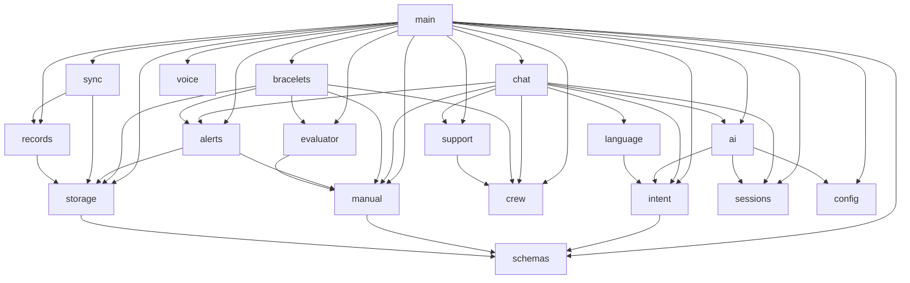

# Backend overview

The backend is a FastAPI service (`Backend/`, version `0.1.0` in `app/__init__.py`) that runs fully offline on the crew's machine. It:

1. **supports and guides** the crew member: chat router, health manual, emotional support, text-to-speech;
2. **alerts** the crew and the on-board medical officer: urgent readings, emergencies detected in the chat, opened maneuver guides;
3. **queues data for Earth** in the background, never blocking anything.

Stack: Python 3.11+, FastAPI (`>=0.115,<1.0`), Uvicorn, Pydantic v2 + pydantic-settings, httpx (Ollama client) and pytest. The voice adds piper-tts, praat-parselmouth, numpy and scipy (optional, GPL-3.0).

## Folder layout

```
Backend/
├── app/
│   ├── __init__.py      version
│   ├── main.py          FastAPI app: Services container, lifespan, every route
│   ├── config.py        Settings (MOON_C_* environment variables, .env)
│   ├── schemas.py       Pydantic models: the API contract
│   ├── chat.py          ChatService: what Moon-C answers to each message
│   ├── intent.py        KeywordRouter: classifies messages with shared/keywords.json
│   ├── language.py      per-message language detection (es/en)
│   ├── ai.py            Ollama client, small talk, canned replies, post-filter
│   ├── sessions.py      in-memory chat context and pending follow-up questions
│   ├── support.py       emotional support guide and private support profiles
│   ├── manual.py        loads and validates shared/protocols.json; localized views
│   ├── evaluator.py     classifies a reading: normal / attention / urgent
│   ├── alerts.py        AlertBoard: vital, report and maneuver alerts (memory)
│   ├── bracelets.py     simulated bracelets: live vital signs and demo emergencies
│   ├── crew.py          CrewRegistry: shared/crew.json
│   ├── storage.py       MeasurementStore: atomic JSON persistence of measurements
│   ├── records.py       RecordStore: maneuver reports, access log, announcements
│   ├── sync.py          EarthSync: simulated queue for Earth
│   └── voice.py         MoonCVoice: loads moonc_voz/ for POST /tts
├── scripts/chat.py      terminal chat helper (development)
├── tests/               pytest suite (mocked Ollama, temporary storage)
├── storage/             runtime data, created on first write (gitignored)
├── requirements.txt
├── requirements-voice.txt   optional voice (includes ../moonc_voz/requirements.txt)
├── pytest.ini
└── .env.example
```

## Module documentation

| Area | Pages |
|---|---|
| Settings | [configuration.md](configuration.md) |
| HTTP API | [api-reference.md](api-reference.md), [data-models.md](data-models.md) |
| Chat | [chat/README.md](chat/README.md), [intent-router.md](chat/intent-router.md), [chat-service.md](chat/chat-service.md), [local-ai.md](chat/local-ai.md), [sessions.md](chat/sessions.md), [emotional-support.md](chat/emotional-support.md) |
| Health | [health/manual.md](health/manual.md), [health/evaluator.md](health/evaluator.md), [health/alerts.md](health/alerts.md), [health/bracelets-and-crew.md](health/bracelets-and-crew.md) |
| Data | [data/storage.md](data/storage.md), [data/earth-sync.md](data/earth-sync.md) |
| Voice | [voice/tts.md](voice/tts.md), [voice/moonc-voz.md](voice/moonc-voz.md) |
| Tests and tools | [testing.md](testing.md) |

## How the modules depend on each other



`schemas.py` and `config.py` sit at the bottom; `main.py` is the only module that knows every service. `voice.py` imports `moonc_voz/moonc_voz.py` dynamically from its folder, so the backend runs without the voice libraries.

## The `Services` container

`main.py` defines a dataclass `Services` holding every long-lived object. `Services.build(settings, ollama_transport=None)` creates them in this order:

| Step | Object | Fails fast if… |
|---|---|---|
| 1 | `Manual.load(shared_dir / "protocols.json")` | the manual is missing a section, a language, a band, or names an unknown `urgent_protocol` (`ManualError`) |
| 2 | `KeywordRouter.load(shared_dir / "keywords.json")` | keywords are malformed, name an unknown indicator or have no emergency phrases (`KeywordsError`) |
| 3 | `CrewRegistry.load(shared_dir / "crew.json")` | duplicate ids/bracelets or unsupported language (`CrewError`) |
| 4 | `SupportGuide.load(shared_dir / "support.json")` | a moment or a language is missing (`SupportError`) |
| 5 | cross-check | a support moment in `keywords.json` has no reply in `support.json` (`SupportError`) |
| 6 | `ProfileStore.load(profiles_dir or shared_dir / "profiles", crew)` | never: invalid, unknown or non-consented profiles are skipped with a warning |
| 7 | `MeasurementStore(storage_path, retention_days).load()` | never: an unreadable file is set aside as `*.corrupt-<time>` |
| 8 | `RecordStore` × 3 in the same folder: `maneuver_reports.json`, `access_log.json`, `announcements.json` | never (same rule) |
| 9 | `AlertBoard(manual)`, `SessionStore(max_turns, ttl_s)`, `OllamaClient(settings, transport)` | — |
| 10 | `SimulatedBracelets(...)` only if `MOON_C_SIMULATION=true` (seeded with `MOON_C_SIM_SEED`) | — |
| 11 | `ChatService(manual, router, crew, sessions, SmallTalk(ai_client), alerts, support, profiles)`, `EarthSync(store, link, reports)`, `MoonCVoice(voice_dir, enabled)`, `BoundedSemaphore(tts_max_concurrent)` | — |

Routes receive the container through the dependency `ServicesDep = Annotated[Services, Depends(get_services)]`. While the app is starting (or after shutdown) `get_services` answers **503 "Moon-C is starting up."**

## Startup and shutdown

`create_app(settings=None, *, ollama_transport=None)` builds the FastAPI app; the module-level `app = create_app()` is what Uvicorn serves (`uvicorn app.main:app`). Tests call `create_app()` with their own settings and a mock Ollama transport.

The `lifespan` context manager:

1. builds `Services` (this is where the shared files are validated);
2. starts the background tasks, all stored in `services.tasks`:
   - `ai_client.warm_up()` if `MOON_C_OLLAMA_WARMUP` (never blocks startup);
   - `_sweep_sessions()` every `session_sweep_interval_s` (60 s);
   - `sync.run(sync_interval_s)`;
   - `asyncio.to_thread(voice.load)` if the voice is enabled (~3 s);
   - `bracelets.run(sim_tick_s)` if the simulation is on;
3. logs `Moon-C 0.1.0 ready (manual <version>, model <model>).`;
4. on shutdown, cancels and awaits every task, closes the httpx client and sets `app.state.services = None`.

The app also installs:

- **CORS** (`CORSMiddleware`) with `cors_origin_list` and `cors_origin_regex` (localhost on any port by default), all methods and headers.
- **A custom 422 handler** (`_validation_error_handler`) that returns only `type`, `loc` and `msg` for each validation error. FastAPI's default echoes the rejected input: that would send health text back to the client, and a NaN input made the default handler crash with a 500.

## Concurrency model

- Run **one process**. Alerts, chat sessions and live signs are in memory.
- `async` routes (`/status`, `/chat`, `/session/reset`, `/identify`) run on the event loop; the rest are plain `def` routes that FastAPI runs in its thread pool.
- Every store guards its state with a lock (`threading.Lock`/`RLock`). File writes from background loops run in `asyncio.to_thread`, so they never block requests.
- `/tts` takes a slot of a `threading.BoundedSemaphore(tts_max_concurrent)` without blocking; when all slots are busy it answers 429 at once. The voice module also serializes synthesis with its own lock.

## Logging

`_configure_logging()` attaches a stream handler at INFO to the `moon_c` logger (Uvicorn configures only its own loggers). Child loggers: `moon_c.ai`, `moon_c.storage`, `moon_c.sync`, `moon_c.support`, `moon_c.voice`, `moon_c.bracelets`.

Rule: **log counts, states and error types only, never message content.** Tests check it (`test_privacy.py`, `test_voice.py::test_spoken_text_is_never_logged`, `test_support.py::test_chat_never_logs_profile_content`).

## Design rules worth knowing before you change code

- **An emergency is never blocked.** An unknown `crew_id` in `/chat` or `/maneuvers/start` is ignored (generic reply, alert without a name); the router checks the emergency keywords of every language, always, before anything else.
- **The AI never decides anything clinical.** Emergencies, health answers, safety questions and their answers are deterministic. The AI only words small talk, listening and (optionally) the injury question, and its replies pass a language check and a keyword post-filter.
- **Fail fast at startup, degrade gracefully at runtime.** Invalid shared files stop the backend; Ollama, the voice or a corrupt data file never do.
- **Clinical wording is conservative** and marked `# supuesto: validar con experto médico` where it still needs review.

## Common changes

| Change | Where | Then |
|---|---|---|
| New keyword or phrase | `shared/keywords.json` | Restart; add a case to `shared/router_cases.json` if it is an emergency phrase |
| Change a range or a protocol step | `shared/protocols.json` (+ `shared/REFERENCES.md`) | Restart; run `pytest` (evaluator boundary tests may need new values) |
| New support reply | `shared/support.json` | Restart |
| New endpoint | a route in `app/main.py`, models in `app/schemas.py`, a tag in `TAGS` | Add tests under `tests/`; add the call to `front-end/src/lib/api.js` if the UI needs it |
| New indicator | `schemas.py` (`IndicatorName`, `INDICATORS`), `protocols.json`, `keywords.json`, and `bracelets.py` / front-end lists if it is a live sign | Run both test suites |
| New setting | `config.py` (`Settings`) and `.env.example` | Document it in [configuration.md](configuration.md) |
