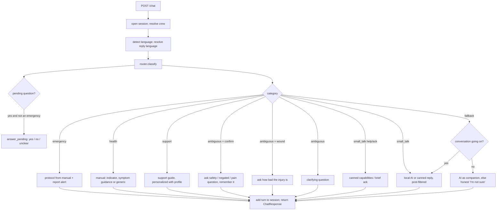

# Chat pipeline

`POST /chat` is handled by `ChatService.handle()` ([chat-service.md](chat-service.md)). It combines five modules:

| Module | Role | Page |
|---|---|---|
| `intent.py` | `KeywordRouter`: classifies the message with `shared/keywords.json` (deterministic, offline) | [intent-router.md](intent-router.md) |
| `chat.py` | `ChatService`: picks the reply for each category, asks and remembers follow-up questions | [chat-service.md](chat-service.md) |
| `ai.py` | `OllamaClient` and `SmallTalk`: local AI for small talk and listening, canned replies, post-filter | [local-ai.md](local-ai.md) |
| `sessions.py` | `SessionStore`: last turns, language and pending question per `session_id`, in memory only | [sessions.md](sessions.md) |
| `support.py` | `SupportGuide` and `ProfileStore`: replies for key mental-health moments, personalized with private profiles | [emotional-support.md](emotional-support.md) |
| `language.py` | `detect_language()`: the language of each message | [below](#language-detection) |

## End-to-end flow



Priority inside `handle()`:

1. An **emergency** always wins, even over a pending question.
2. Otherwise, if a question is pending (asked by Moon-C within the last 2 minutes), the message is read as its **answer** when it can be.
3. Otherwise the router's category decides.

## Categories at a glance

| Category | Example message | What Moon-C does | AI called? |
|---|---|---|---|
| `emergency` | "me duele el pecho", "I can't breathe", "ya no quiero vivir" | Opening line + protocol steps from the manual. Raises a `report` alert if the crew member is identified | Never |
| `health` (symptom) | "I feel sick", "me duele la cabeza" | `feeling_unwell` guidance from the manual | Never |
| `health` (indicator) | "what is a normal pulse?" | Indicator explanation, normal range and how to measure | Never |
| `support` | "I'm so stressed", "extraño a mi familia" | Reply from `support.json`, or the crew member's own reply from their profile | Never for this reply |
| `ambiguous` + `confirm` | "heart attack", "no sangra", "me molesta el pecho", "help me" | A safety question with yes/no buttons; only a "yes" opens the protocol | Never |
| `ambiguous` + `wound` | "me corté", "I fell", "me quemé" | Asks how bad it is (cut: is it bleeding heavily?) | Only to word the cut question |
| `ambiguous` | "I feel weird" | "Does something hurt, or do you feel tired?" | Never |
| `small_talk` | "hola", "thanks", "how are you?" | Local AI (with the profile's notes) or a canned reply | Yes |
| `small_talk` (`help`, `ack`) | "what can you do?", "ok", "jaja", 👍 | Capabilities with buttons / a brief natural reply | Never |
| `fallback` | "What time is the docking?" | The AI answers as a companion; without AI an honest "I'm not sure" with topic buttons | Yes |

## Language resolution

The reply language is decided before routing:

```
lang = detect_language(message)          # the message itself, when clear
    or session.language                  # the last language detected in this session
    or request.language                  # what the client sent
    or crew.preferredLanguage            # the crew member's profile
    or "en"
```

A clear detection is saved in the session (`SessionStore.set_language`), so an unclear follow-up ("ok", "SpO2") keeps the language in use. A crew switch or a reset forgets it.

The AI is told the reply language explicitly, and an AI reply detected in the other language is replaced by a canned one. So `ChatResponse.language` always matches the reply text, and the front-end reads it with the right voice.

### Language detection

Source: [`Backend/app/language.py`](../../../Backend/app/language.py). Front-end mirror: [`front-end/src/lib/language.js`](../../../front-end/src/lib/language.js).

`detect_language(text) -> "es" | "en" | None`:

1. Normalize the text like the router (lowercase, no accents or apostrophes, punctuation → spaces) and split into words.
2. Count whole-word hits in two hand-made sets of very common words that belong to only one language (`_ES`: "hola", "gracias", "estoy", "duele", "pecho"…; `_EN`: "hi", "thanks", "the", "can't" → "cant", "breathe", "chest"…). Words both languages share ("no", "me", "a") are left out.
3. More Spanish hits → `es`; more English hits → `en`; a tie or no hits → `None` (unclear).

Examples from `shared/language_cases.json`: "Hola, how are you?" → `en` (more English words); "Guide me through CPR" → `None` (no listed words); "ok gracias thanks" → `None` (tie).

Rules for editing the word lists:

- Add only words that cannot appear in the other language.
- Change **both** `language.py` and `language.js`: `test_router_flows.py::test_language_word_lists_match_the_front_end` compares the two sets.
- Add a case to `shared/language_cases.json` for the behavior you want.

## Privacy in the pipeline

- Messages are never written to disk or logged. Only the last 10 turns live in memory, per session, and expire after 10 minutes of inactivity ([sessions.md](sessions.md)).
- Health turns are not sent to the AI: only `small_talk` and `support` turns form the AI's history.
- An alert raised from the chat keeps only the protocol name, never the text.
